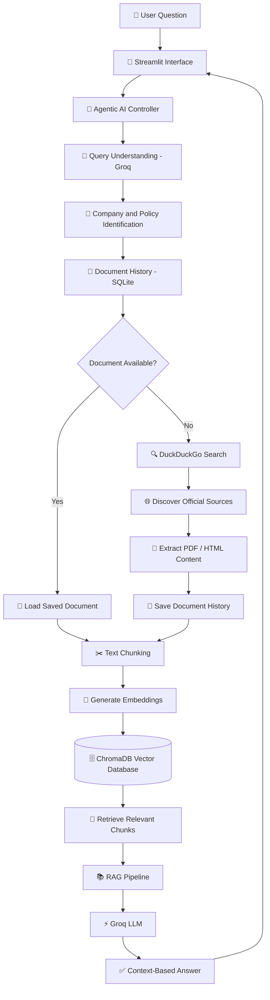

# 🚀 PolicyPilot AI

### Your Intelligent Gateway to Company Policies

**Ask Smarter. Discover Faster. Understand Better.**

An Agentic AI-powered company policy assistant that discovers official policy documents and transforms them into clear, context-aware answers using Retrieval-Augmented Generation (RAG) and Large Language Models.


\


[GitHub Repository](https://github.com/arjunrajaner-code/PolicyPilot-AI) | [Features](#-key-features) | [Architecture](#-system-architecture) | [Installation](#-installation--setup)

---

## 💡 About the Project

Finding accurate company policy information can be difficult. Employees often need to search through multiple websites, lengthy documents, and different information sources to understand company rules and benefits.

**PolicyPilot AI** simplifies this process through an intelligent conversational assistant.

Users can ask questions in natural language, such as:

- Does Amazon provide paid leave?
- What is Google's work-from-home policy?
- What are the company's employee benefits?

The system understands the question, identifies the company and policy topic, discovers relevant policy documents, retrieves useful information, and generates a context-based response using an LLM.

### 🎯 Project Objective

To develop an intelligent Agentic AI system that automates company policy discovery and helps users understand policy information through conversational AI.

---

## ❓ Problem Statement

Traditional company policy discovery involves several challenges:

- Manually searching multiple company websites.
- Reading lengthy policy documents.
- Difficulty identifying relevant information.
- Repeated searches for previously discovered documents.
- Finding meaningful information using simple keyword searches.

### 💡 Our Solution

PolicyPilot AI combines Agentic AI, automated document discovery, semantic search, and RAG to simplify the entire process.

| Traditional Approach         | PolicyPilot AI             |
| ---------------------------- | -------------------------- |
| Manual document searching    | Automated policy discovery |
| Reading lengthy documents    | Context-based AI responses |
| Repeated document searches   | Document history and reuse |
| Keyword-based searching      | Semantic retrieval         |
| Multiple information sources | Conversational interface   |

---

## ✨ Key Features

### 🤖 1. Agentic AI Query Understanding

- Understands natural language questions.
- Identifies the company name.
- Extracts the relevant policy topic.
- Determines whether the query relates to company policies.

### 🔍 2. Intelligent Policy Discovery

- Uses DuckDuckGo search to discover policy documents.
- Searches for relevant company information.
- Prioritizes official company domains.
- Identifies potential document sources.

### 📄 3. Automated Document Processing

- Extracts text from supported PDF and HTML documents.
- Processes extracted content.
- Divides information into manageable text chunks.

### 🧠 4. Semantic Search

- Generates embeddings using Sentence Transformers.
- Uses ChromaDB for vector storage.
- Retrieves relevant document chunks based on semantic similarity.

### 📚 5. RAG-Based Question Answering

- Combines retrieved document context with an LLM.
- Generates context-grounded responses.
- Provides available source information.
- Reduces unsupported answers through context-based prompting.

### 💾 6. Document History Management

- Uses SQLite to maintain document history.
- Checks previously saved documents.
- Reuses suitable saved documents based on the configured freshness policy.

### ⚡ 7. Groq LLM Integration

- Uses Groq API for language model inference.
- Supports query understanding and answer generation.
- Provides configurable model settings.

### 💬 8. Interactive Web Interface

- Built using Streamlit.
- Provides a conversational user experience.
- Allows users to ask company policy questions.

---

## 🏗️ System Architecture

PolicyPilot AI follows an Agentic AI and Retrieval-Augmented Generation architecture.



---

## 🔄 How It Works

| Step | Process                           | Technology            |
| ---- | --------------------------------- | --------------------- |
| 01   | Receive user question             | Streamlit             |
| 02   | Understand the query              | Groq LLM              |
| 03   | Identify company and policy topic | Agentic AI            |
| 04   | Check document history            | SQLite                |
| 05   | Discover policy documents         | DuckDuckGo            |
| 06   | Extract document content          | PyPDF / BeautifulSoup |
| 07   | Split content into chunks         | Python                |
| 08   | Generate embeddings               | Sentence Transformers |
| 09   | Store and retrieve vectors        | ChromaDB              |
| 10   | Generate contextual answers       | RAG + Groq            |

---

## 🛠️ Technology Stack

| Category               | Technology                               |
| ---------------------- | ---------------------------------------- |
| Programming Language   | Python                                   |
| LLM Provider           | Groq API                                 |
| LLM Model              | `openai/gpt-oss-20b`                     |
| Frontend               | Streamlit                                |
| AI Architecture        | Agentic AI                               |
| Retrieval Architecture | RAG                                      |
| Embedding Model        | `sentence-transformers/all-MiniLM-L6-v2` |
| Vector Database        | ChromaDB                                 |
| Web Search             | DuckDuckGo                               |
| Database               | SQLite                                   |
| PDF Processing         | PyPDF                                    |
| HTML Processing        | BeautifulSoup                            |
| HTTP Requests          | Requests                                 |
| Environment Management | Python-dotenv                            |

---

## 📂 Project Structure

```text
PolicyPilot-AI/
│
├── app.py                  # Streamlit application
├── agent.py                # Agentic AI controller
├── rag_chat.py             # RAG question-answering pipeline
│
├── web_search.py            # Company policy discovery
├── document_loader.py      # PDF and HTML document extraction
├── document_history.py     # SQLite history management
│
├── chunk_text.py            # Text chunking
├── build_vector_db.py       # Embedding and vector database setup
├── read_pdf.py              # PDF reading utility
│
├── requirements.txt          # Project dependencies
├── .gitignore                # Git ignored files
├── README.md                 # Project documentation
│
└── Local Data
    ├── documents/
    ├── data/
    ├── chroma_db/
    └── document_history.db
```

*Note: Local documents, generated vector databases, environment secrets, and temporary data are excluded from the public Git repository.*

---

## 🚀 Installation & Setup

Follow these steps to run PolicyPilot AI on your local machine.

### Prerequisites

- Python 3.10 or later
- Git
- VS Code or another Python IDE
- Groq API key

### Step 1: Clone the Repository

```bash
git clone https://github.com/arjunrajaner-code/PolicyPilot-AI.git
```

### Step 2: Navigate to the Project

```bash
cd PolicyPilot-AI
```

### Step 3: Create a Virtual Environment

```bash
python -m venv venv
```

Activate on Windows PowerShell:

```powershell
.\venv\Scripts\Activate.ps1
```

### Step 4: Install Dependencies

```bash
pip install -r requirements.txt
```

### Step 5: Configure Environment Variables

Create a `.env` file in the project root directory.

Add the following configuration:

```env
GROQ_API_KEY=your_groq_api_key
GROQ_MODEL=openai/gpt-oss-20b
```

Replace `your_groq_api_key` with your actual Groq API key.

**Security Notice:** Never upload your `.env` file or expose API credentials in your public repository.

### Step 6: Run the Application

```bash
streamlit run app.py
```

Open the local URL displayed in your terminal to access the application.

---

## 💬 Example Questions

Try asking PolicyPilot AI questions like these:

### 🏖️ Leave and Holiday Policies

- Does Amazon provide paid leave?
- What is the maternity leave policy?
- How many annual leave days are available?

### 🏠 Work From Home Policies

- Does Google allow employees to work remotely?
- What are Microsoft's remote work guidelines?

### 💰 Salary and Employee Benefits

- Does the company provide salary during approved leave?
- What employee benefits are mentioned in the policy?

### 🏢 Workplace Guidelines

- What are the company's attendance rules?
- What is the company's holiday policy?

*The availability and accuracy of answers depend on the relevance and completeness of the retrieved documents.*

---

## 🔐 Reliability and Responsible AI

PolicyPilot AI is designed to generate answers based on retrieved document context.

- Prioritizes official company sources where available.
- Uses retrieved information as the basis for answer generation.
- May indicate when sufficient evidence is unavailable.
- Does not guarantee that every discovered document is current or complete.
- Company policies may differ by country, employment type, and employee category.
- Important employment decisions should always be verified against official HR documentation.

---

## 🗺️ Future Enhancements

The following improvements are planned for future versions:

- [ ] Country-specific policy identification.
- [ ] Employee-type-aware policy retrieval.
- [ ] Advanced multi-agent orchestration.
- [ ] Improved official-source verification.
- [ ] RAG evaluation using TruLens.
- [ ] Real-time document freshness monitoring.
- [ ] Streaming AI responses.
- [ ] Enhanced conversation memory.
- [ ] Cloud deployment.
- [ ] Automated testing and CI/CD integration.

---

## 🎯 Project Vision

PolicyPilot AI demonstrates how modern AI technologies can transform traditional information discovery into an intelligent conversational experience.

By combining Agentic AI, Large Language Models, RAG, semantic search, and automated document discovery, the project aims to make complex company policy information more accessible and understandable.

---

## 👨‍💻 Developed By

### Arjun Rajan

**AI & Data Science | AI Engineering | Agentic AI**


---

\<p align="center">

⭐ If you find this project interesting, consider giving the repository a star!

**PolicyPilot AI**

*Making Company Policies Easier to Understand.* 🚀

\</p>
