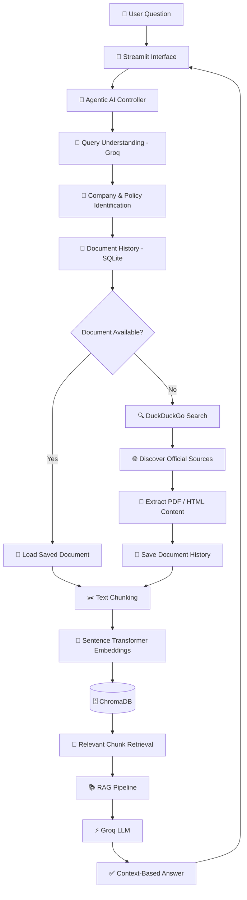

# 🚀 PolicyPilot AI

### Your Intelligent Gateway to Company Policies

\<p align="center">
&#x20; \<b>Ask Smarter. Discover Faster. Understand Better.\</b>
\</p>

\<p align="center">
&#x20; An Agentic AI-powered company policy assistant that discovers official policy documents and transforms them into clear, context-aware answers using RAG and Large Language Models.
\</p>

\<p align="center">
&#x20; \
&#x20; \
&#x20; \
&#x20; \
&#x20; \
\</p>

\<p align="center">
&#x20; \<a href="[https://github.com/arjunrajaner-code/PolicyPilot-AI](https://github.com/arjunrajaner-code/PolicyPilot-AI)">GitHub Repository\</a> •
&#x20; \<a href="#-features">Features\</a> •
&#x20; \<a href="#-architecture">Architecture\</a> •
&#x20; \<a href="#-installation--setup">Installation\</a>
\</p>

---

## 💡 What is PolicyPilot AI?

Finding company policies shouldn't feel like searching for a needle in a haystack.

Employees often struggle to find accurate information about leave policies, salary benefits, holidays, remote work, and workplace guidelines.

**PolicyPilot AI** simplifies this experience.

It is an intelligent assistant that understands natural language questions, identifies the relevant company and policy topic, discovers official policy documents, and generates answers using a Retrieval-Augmented Generation (RAG) pipeline.

Instead of manually searching multiple websites and documents, users can simply ask a question and receive an AI-generated response based on retrieved policy information.

> **The vision:** Make company policy information easier to discover, access, and understand.

---

## 🎯 The Problem We Solve

| Traditional Approach                | PolicyPilot AI                       |
| ----------------------------------- | ------------------------------------ |
| Manually searching company websites | Automated policy discovery           |
| Reading lengthy documents           | Context-based AI answers             |
| Repeated document searches          | Document history and reuse           |
| Keyword-based searching             | Semantic search                      |
| Switching between multiple sources  | Centralized conversational interface |

---

## ✨ Features That Make It Intelligent

### 🤖 Agentic AI Query Understanding

Understands natural language questions and identifies the company and relevant policy topic using an LLM.

### 🔍 Intelligent Policy Discovery

Uses DuckDuckGo search to discover relevant company policy documents and prioritizes official company sources.

### 📄 Automated Document Processing

Extracts text from supported PDF and HTML documents and prepares the content for retrieval.

### 🧠 Semantic Search Engine

Uses Sentence Transformers to generate embeddings and ChromaDB to retrieve relevant document chunks.

### 📚 Retrieval-Augmented Generation

Combines retrieved policy context with Groq LLM to generate relevant, context-grounded answers.

### 💾 Smart Document History

Uses SQLite to store document history and reuse suitable previously saved documents based on the configured freshness policy.

### ⚡ Groq LLM Integration

Uses Groq API for fast language model inference and natural language understanding.

### 💬 Interactive AI Interface

Provides a conversational experience through a Streamlit-based web application.

---

## 🏗️ Architecture

PolicyPilot AI combines Agentic AI, document discovery, semantic retrieval, and LLM-powered answer generation.



---

## ⚙️ How the System Works

| Stage | Process                            | Technology            |
| ----- | ---------------------------------- | --------------------- |
| 01    | Understand user query              | Groq LLM              |
| 02    | Identify company and policy topic  | Agentic AI            |
| 03    | Check saved document history       | SQLite                |
| 04    | Discover relevant policy documents | DuckDuckGo            |
| 05    | Extract document content           | BeautifulSoup / PyPDF |
| 06    | Split content into chunks          | Python                |
| 07    | Generate vector embeddings         | Sentence Transformers |
| 08    | Store and retrieve information     | ChromaDB              |
| 09    | Generate contextual answers        | RAG + Groq            |

---

## 🛠️ Technology Stack

\<p align="center">
&#x20; \
\</p>

| Category             | Technologies            |
| -------------------- | ----------------------- |
| Programming Language | Python                  |
| Large Language Model | Groq API                |
| LLM Model            | `openai/gpt-oss-20b`    |
| Frontend             | Streamlit               |
| AI Architecture      | Agentic AI, RAG         |
| Embedding Model      | `all-MiniLM-L6-v2`      |
| Vector Database      | ChromaDB                |
| Search               | DuckDuckGo              |
| Database             | SQLite                  |
| Document Processing  | PyPDF, BeautifulSoup    |
| API & Configuration  | Requests, Python-dotenv |

---

## 📂 Project Structure

```text
PolicyPilot-AI/
│
├── app.py                  # Streamlit user interface
├── agent.py                # Agentic AI controller
├── rag_chat.py             # RAG question-answering pipeline
│
├── web_search.py            # Company policy discovery
├── document_loader.py      # PDF and HTML extraction
├── document_history.py     # SQLite history management
│
├── chunk_text.py            # Text chunking
├── build_vector_db.py       # Embedding and ChromaDB setup
├── read_pdf.py              # PDF reading utility
│
├── requirements.txt          # Project dependencies
├── .env.example              # Environment configuration template
├── .gitignore                # Git ignored files
└── README.md                 # Project documentation
```

*Generated vector databases, local documents, environment secrets, and temporary data are maintained locally and excluded from version control.*

---

## 🚀 Installation & Setup

Follow these steps to run PolicyPilot AI locally.

### 1. Clone the Repository

```bash
git clone https://github.com/arjunrajaner-code/PolicyPilot-AI.git
```

```bash
cd PolicyPilot-AI
```

### 2. Create a Virtual Environment

```bash
python -m venv venv
```

Activate on Windows:

```powershell
.\venv\Scripts\Activate.ps1
```

### 3. Install Dependencies

```bash
pip install -r requirements.txt
```

### 4. Configure API Credentials

Create a `.env` file in the root directory.

```env
GROQ_API_KEY=your_groq_api_key
GROQ_MODEL=openai/gpt-oss-20b
```

Replace the placeholder with your own Groq API key.

**Security:** Never commit your `.env` file or expose API credentials in your repository.

### 5. Launch the Application

```bash
streamlit run app.py
```

Open the local URL displayed in your terminal to interact with the application.

---

## 💬 Try Asking PolicyPilot AI

Here are some example questions:

**🏖️ Leave & Holidays**

- Does Amazon provide paid leave?
- What is the maternity leave policy?
- How many annual leave days are available?

**🏠 Remote Work**

- Does Google allow employees to work remotely?
- What are Microsoft's work-from-home guidelines?

**💰 Salary & Benefits**

- Does the company provide salary during approved leave?
- What employee benefits are mentioned in the policy?

**🏢 Workplace Guidelines**

- What are the company's attendance rules?
- What is the holiday policy?

*Actual answers depend on the availability, relevance, and accuracy of retrieved documents.*

---

## 🔐 Reliability & Responsible AI

PolicyPilot AI is designed to generate answers using retrieved document context.

- Prioritizes official company sources where available.
- Uses retrieved information as the basis for answer generation.
- May report insufficient evidence when relevant information is unavailable.
- Does not guarantee that every discovered document is current or complete.
- Company policies may vary by country, employee category, and employment status.
- Important employment decisions should always be verified against official HR documentation.

---

## 🗺️ Future Roadmap

The project can be extended with the following capabilities:

- [ ] Country-specific policy identification
- [ ] Employee-type-aware policy retrieval
- [ ] Advanced multi-agent orchestration
- [ ] Improved source verification
- [ ] RAG evaluation using TruLens
- [ ] Real-time document freshness monitoring
- [ ] Streaming AI responses
- [ ] Enhanced conversation memory
- [ ] Cloud deployment
- [ ] Automated testing and CI/CD

---

## 🎯 Project Vision

PolicyPilot AI demonstrates how modern AI technologies can transform traditional information discovery into an intelligent conversational experience.

By combining Agentic AI, LLMs, RAG, semantic search, and automated document discovery, the project aims to make complex company policy information more accessible and understandable.

---

## 👨‍💻 Developed By

### Arjun Rajan

**AI & Data Science | AI Engineering | Agentic AI**

\<p>
&#x20; \<a href="[https://github.com/arjunrajaner-code](https://github.com/arjunrajaner-code)">
&#x20;   \
&#x20; \</a>
\</p>

---

\<p align="center">
&#x20; ⭐ If you find this project interesting, consider giving it a star!
\</p>

\<p align="center">
&#x20; \<b>PolicyPilot AI\</b>\<br/>
&#x20; Making Company Policies Easier to Understand. 🚀
\</p>
